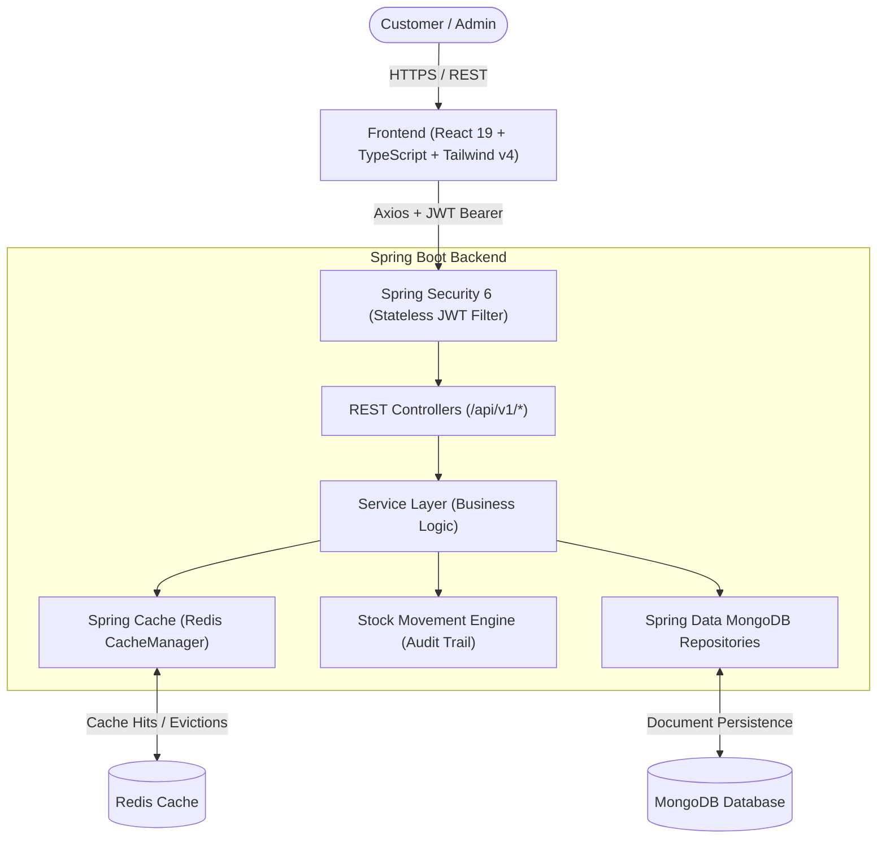
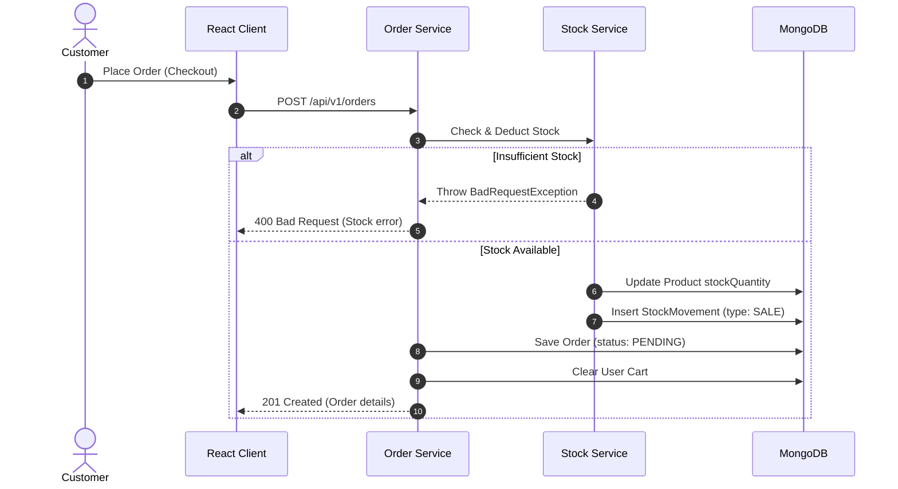

# 🛒 Enterprise E-Commerce Platform

[](https://openjdk.org/)
[](https://spring.io/projects/spring-boot)
[](https://spring.io/projects/spring-security)
[](https://www.mongodb.com/)
[](https://redis.io/)
[](https://react.dev/)
[](https://www.typescriptlang.org/)
[](https://tailwindcss.com/)
[](https://vitejs.dev/)

An end-to-end, full-stack enterprise e-commerce platform built with **Java 21**, **Spring Boot 3.4**, **MongoDB**, **Redis**, and a modern **React 19 / TypeScript / Tailwind CSS** frontend. 

Designed with domain-driven principles, stateless JWT authentication, distributed caching, an immutable stock audit trail, atomic inventory updates, and an admin management back-office.

---

## 📑 Table of Contents

- [Architectural Overview](#-architectural-overview)
- [Key Features](#-key-features)
  - [Customer Experience](#customer-experience)
  - [Inventory & Stock Audit Engine](#inventory--stock-audit-engine)
  - [Order & Coupon Processing](#order--coupon-processing)
  - [Admin Back-Office Suite](#admin-back-office-suite)
  - [User Experience & Notifications](#user-experience--notifications)
- [Tech Stack](#-tech-stack)
- [System Architecture](#-system-architecture)
- [Project Directory Structure](#-project-directory-structure)
- [REST API Reference](#-rest-api-reference)
- [Database Schema & Collections](#-database-schema--collections)
- [Getting Started](#-getting-started)
  - [Prerequisites](#prerequisites)
  - [Database & Cache Setup (Docker)](#database--cache-setup-docker)
  - [Backend Setup (Spring Boot)](#backend-setup-spring-boot)
  - [Frontend Setup (React + Vite)](#frontend-setup-react--vite)
- [Security & Authentication](#-security--authentication)
- [Caching Strategy](#-caching-strategy)
- [License](#-license)

---

## 🏛 Architectural Overview



---

## ✨ Key Features

### Customer Experience
* **Dynamic Catalog & Multi-Criteria Filtering**: Filter products by category, price ranges, in-stock status, and search keywords with server-side pagination and dynamic sorting.
* **Product Details & Customer Reviews**: Detailed views displaying real-time stock levels, high-resolution imagery, verified reviews, and 5-star aggregate rating calculations.
* **Synchronized Shopping Cart**: Persistent, user-bound cart with dynamic subtotal calculations, instant quantity modifications, and pre-checkout stock validations.
* **Wishlist Management**: One-click wishlist toggle with both a slide-over quick drawer and a dedicated full wishlist view.
* **User Address Book**: Manage multiple delivery addresses directly from the profile or during checkout.

### Inventory & Stock Audit Engine
* **Immutable Stock Movements (`StockMovement`)**: Complete audit trail of all inventory events. Records are write-only and cannot be altered or deleted.
* **Movement Categorization**:
  * `SALE`: Automatic deduction upon successful order placement.
  * `CANCEL`: Instant inventory restoration upon customer or admin order cancellation.
  * `RESTOCK`: Inventory entry when creating products or restocking shelves.
  * `ADJUSTMENT`: Manual administrative adjustments (e.g., physical count variances, waste, damages).
* **Denormalized Audit Records**: Retains historical product names even if a product is modified or deleted later.
* **Atomic Deductions**: Safe stock decrements to eliminate race conditions and overselling.

### Order & Coupon Processing
* **Atomic Order Creation**: Validates cart contents, verifies available quantities, deducts stock, records audit movements, applies validated coupons, and snapshots product details into immutable order items.
* **Order Lifecycle Management**: Full tracking through states: `PENDING` ➔ `PROCESSING` ➔ `SHIPPED` ➔ `DELIVERED` ➔ `CANCELLED`.
* **Flexible Coupon Engine**:
  * Percentage-based (`PERCENTAGE`) and fixed-amount (`FIXED_AMOUNT`) discounts.
  * Minimum order amount thresholds, usage limits, and expiration dates.
  * Real-time coupon validation endpoint for seamless checkout feedback.

### Admin Back-Office Suite
* **Comprehensive Dashboard**: Centralized operations portal with role-protected routing (`ROLE_ADMIN`).
* **Product & Category CRUD**: Rich forms for catalog management, stock replenishment, and category hierarchy.
* **Bulk Inventory Operations**: Update multiple stock quantities at once with itemized success and failure tracking.
* **Stock Audit History**: Inspect, search, and filter inventory movements across date ranges, products, and movement types.
* **Order Management**: Review customer orders, update delivery tracking statuses, and process cancellations.
* **User & Role Administration**: Manage registered users, inspect permissions, promote roles, and activate or suspend accounts.

### User Experience & Notifications
* **Purpose-Driven Toast Notification System**: Non-intrusive notification architecture reserving pop-up alerts strictly for important milestones (order placement, cancellations, coupon validation, review submissions) to eliminate notification fatigue.
* **Slide-over Drawers**: Smooth slide-over drawers for Cart and Wishlist to maintain uninterrupted browsing flows.
* **Form Validation**: Strict client-side validation using **React Hook Form** paired with **Zod** schemas alongside standard Spring Boot **JSR-380 Bean Validation** on the backend.

---

## 💻 Tech Stack

### Backend
| Technology | Version | Purpose |
| :--- | :--- | :--- |
| **Java** | 21 (LTS) | Modern core language runtime |
| **Spring Boot** | 3.4.1 | Micro-framework & REST API foundation |
| **Spring Security** | 6.x | Stateless security, authorization & RBAC |
| **JJWT (Java JWT)** | 0.12.5 | Compact, URL-safe token generation & parsing |
| **Spring Data MongoDB** | 3.4.x | Document database mapping & custom criteria querying |
| **Spring Data Redis** | 3.4.x | Distributed cache management & session offloading |
| **MapStruct** | 1.6.3 | High-performance, compile-time DTO ↔ Entity mapping |
| **Lombok** | 1.18.x | Boilerplate reduction for models and builders |
| **Apache Commons Pool2** | 2.x | High-throughput Redis connection pooling |

### Frontend
| Technology | Version | Purpose |
| :--- | :--- | :--- |
| **React** | 19.2.x | Component-driven user interface library |
| **TypeScript** | 5.x / 6.x | Strict compile-time typing across the entire UI |
| **Vite** | 6.x | Next-generation frontend build tooling & dev server |
| **Tailwind CSS** | v4 | Modern styling with utility-first CSS |
| **React Router** | v7 | Declarative client-side routing & route guards |
| **React Hook Form** | 7.x | Controlled & performant form state management |
| **Zod** | 4.x | Declarative schema validation |
| **Axios** | 1.x | Promise-based HTTP client with interceptors |
| **Lucide React** | 1.x | Clean, consistent SVG icon set |

---

## 📐 System Architecture

### High-Level Stock Flow & Order Lifecycle



---

## 📂 Project Directory Structure

```text
e-commerce/
├── pom.xml                               # Root Maven Project Configuration
├── mvnw / mvnw.cmd                       # Maven Wrapper Executables
├── src/                                  # Spring Boot Backend Source
│   ├── main/
│   │   ├── java/com/ecommerce/api/
│   │   │   ├── Application.java          # Spring Boot Application Entrypoint
│   │   │   ├── config/                   # Mongo, Redis, and Security Configurations
│   │   │   ├── controller/               # REST Controllers (Public, Customer, Admin)
│   │   │   ├── dto/                      # Request / Response Transfer Objects
│   │   │   ├── exception/                # Global Exception Handler & Custom Errors
│   │   │   ├── mapper/                   # MapStruct Converters
│   │   │   ├── model/                    # MongoDB Document Models & Enums
│   │   │   ├── repository/               # Mongo Repositories & Custom Criteria Queries
│   │   │   ├── security/                 # JWT Filters, UserDetails & JwtService
│   │   │   ├── service/                  # Business Logic Layer & Implementations
│   │   │   └── validation/               # Custom Bean Validation Annotations
│   │   └── resources/
│   │       └── application.yml           # Application Profiles & Connection Properties
│   └── test/                             # Automated Tests
│
└── frontend/                             # React + Vite Frontend Application
    ├── package.json                      # Node Dependencies & Scripts
    ├── vite.config.ts                    # Vite Configuration
    ├── tsconfig.json                     # TypeScript Configuration
    ├── src/
    │   ├── main.tsx                      # Frontend Entrypoint
    │   ├── App.tsx                       # Route Configuration & Context Providers
    │   ├── api/                          # Axios Client & Modular API Services
    │   ├── assets/                       # Static Assets & SVGs
    │   ├── components/                   # Reusable Components (Drawers, Modals, Forms)
    │   │   ├── admin/                    # Admin Layout & Dashboard Components
    │   │   ├── cart/                     # Cart Drawer & Cart Items
    │   │   ├── layout/                   # Navbar, Footer, MainLayout
    │   │   ├── product/                  # ProductCard, ProductFilter
    │   │   ├── review/                   # StarRating, ReviewList, ReviewForm
    │   │   ├── toast/                    # ToastContainer & ToastItem Notifications
    │   │   └── wishlist/                 # Wishlist Drawer & Toggle Controls
    │   ├── context/                      # React Contexts (Auth, Cart, Wishlist, Toast)
    │   ├── pages/                        # Page Views (Home, Catalog, Checkout, Profile)
    │   │   └── admin/                    # Admin Management Pages (Stock, Products, Orders...)
    │   ├── types/                        # TypeScript Interfaces & API Types
    │   └── utils/                        # Utility Functions (Tailwind cn merge)
```

---

## 🔌 REST API Reference

All API routes are prefixed with `/api/v1`.

### 🔑 Authentication (`/api/v1/auth`)
| Method | Endpoint | Access | Description |
| :--- | :--- | :--- | :--- |
| `POST` | `/api/v1/auth/register` | Public | Register a new customer account |
| `POST` | `/api/v1/auth/login` | Public | Authenticate and obtain JWT token |

### 📦 Products & Catalog (`/api/v1/products`)
| Method | Endpoint | Access | Description |
| :--- | :--- | :--- | :--- |
| `GET` | `/api/v1/products` | Public | Search products with dynamic criteria, sorting, & pagination |
| `GET` | `/api/v1/products/{id}` | Public | Retrieve detailed product information by ID |

### 🏷️ Categories (`/api/v1/categories`)
| Method | Endpoint | Access | Description |
| :--- | :--- | :--- | :--- |
| `GET` | `/api/v1/categories` | Public | List all active product categories |
| `GET` | `/api/v1/categories/{id}` | Public | Get category details |

### 🛒 Shopping Cart (`/api/v1/cart`)
| Method | Endpoint | Access | Description |
| :--- | :--- | :--- | :--- |
| `GET` | `/api/v1/cart` | Customer | Fetch current user's shopping cart |
| `POST` | `/api/v1/cart/items` | Customer | Add an item to the cart |
| `PUT` | `/api/v1/cart/items/{productId}` | Customer | Update item quantity in the cart |
| `DELETE`| `/api/v1/cart/items/{productId}` | Customer | Remove an item from the cart |
| `DELETE`| `/api/v1/cart` | Customer | Clear entire cart |

### 📋 Orders (`/api/v1/orders`)
| Method | Endpoint | Access | Description |
| :--- | :--- | :--- | :--- |
| `POST` | `/api/v1/orders` | Customer | Create order from cart with address & coupon |
| `GET` | `/api/v1/orders/{id}` | Customer | Get order details by ID |
| `GET` | `/api/v1/orders/my-orders` | Customer | List all past orders for authenticated user |
| `PATCH`| `/api/v1/orders/{id}/cancel` | Customer | Cancel pending order & restore inventory |

### 🎟️ Coupons (`/api/v1/coupons`)
| Method | Endpoint | Access | Description |
| :--- | :--- | :--- | :--- |
| `POST` | `/api/v1/coupons/validate` | Customer | Validate coupon code against minimum cart total |

### ⭐ Reviews (`/api/v1/reviews`)
| Method | Endpoint | Access | Description |
| :--- | :--- | :--- | :--- |
| `GET` | `/api/v1/reviews/products/{productId}` | Public | Get paginated reviews for a product |
| `GET` | `/api/v1/reviews/products/{productId}/rating` | Public | Get aggregate rating statistics |
| `POST` | `/api/v1/reviews` | Customer | Submit a rating and written review |
| `PUT` | `/api/v1/reviews/{id}` | Customer | Update existing review |
| `DELETE`| `/api/v1/reviews/{id}` | Customer | Delete review |

### 💖 Wishlist (`/api/v1/wishlist`)
| Method | Endpoint | Access | Description |
| :--- | :--- | :--- | :--- |
| `GET` | `/api/v1/wishlist` | Customer | Retrieve user's wishlist |
| `POST` | `/api/v1/wishlist/toggle/{productId}` | Customer | Toggle product in/out of wishlist |
| `DELETE`| `/api/v1/wishlist/items/{productId}` | Customer | Remove specific product from wishlist |

### 📍 Addresses (`/api/v1/users/me/addresses`)
| Method | Endpoint | Access | Description |
| :--- | :--- | :--- | :--- |
| `GET` | `/api/v1/users/me/addresses` | Customer | List saved addresses |
| `POST` | `/api/v1/users/me/addresses` | Customer | Add a new shipping/billing address |
| `PUT` | `/api/v1/users/me/addresses/{index}` | Customer | Update existing address by index |
| `DELETE`| `/api/v1/users/me/addresses/{index}` | Customer | Remove address |

### 🛠️ Admin Back-Office (`/api/v1/admin/**`)
| Method | Endpoint | Access | Description |
| :--- | :--- | :--- | :--- |
| `POST` | `/api/v1/admin/products` | Admin | Create a new product (triggers RESTOCK movement) |
| `PUT` | `/api/v1/admin/products/{id}` | Admin | Update product details |
| `DELETE`| `/api/v1/admin/products/{id}` | Admin | Soft-delete product |
| `POST` | `/api/v1/admin/stock/bulk` | Admin | Bulk inventory updates with detailed outcome reports |
| `POST` | `/api/v1/admin/stock/{id}/add` | Admin | Increase inventory (`RESTOCK`) |
| `POST` | `/api/v1/admin/stock/{id}/deduct` | Admin | Decrease inventory (`ADJUSTMENT`) |
| `POST` | `/api/v1/admin/stock/{id}/adjust` | Admin | Set exact stock level (`ADJUSTMENT`) |
| `GET` | `/api/v1/admin/stock/movements` | Admin | Query immutable stock audit logs with date/type filters |
| `GET` | `/api/v1/admin/stock/low-stock` | Admin | Retrieve products below warning threshold |
| `GET` | `/api/v1/admin/orders` | Admin | List all system orders with status filter |
| `PATCH`| `/api/v1/admin/orders/{id}/status` | Admin | Advance order status (`PROCESSING`, `SHIPPED`, etc.) |
| `POST` | `/api/v1/admin/coupons` | Admin | Create discount coupon |
| `PATCH`| `/api/v1/admin/coupons/{id}/toggle` | Admin | Enable/disable coupon code |
| `GET` | `/api/v1/admin/users` | Admin | List users with search and role filters |
| `PATCH`| `/api/v1/admin/users/{id}/status` | Admin | Suspend or reactivate user accounts |
| `PATCH`| `/api/v1/admin/users/{id}/role` | Admin | Update user privileges (`ROLE_USER`, `ROLE_ADMIN`) |

---

## 🗄️ Database Schema & Collections

MongoDB document models mapped via Spring Data:

* **`users`**: User identities, hashed credentials (BCrypt), roles (`ROLE_USER`, `ROLE_ADMIN`), account status (`ACTIVE`, `SUSPENDED`), and embedded address lists.
* **`products`**: Product details, SKUs, pricing, stock levels (`stockQuantity`), categories, active status flags, and timestamps.
* **`categories`**: Product taxonomy, display names, and descriptions.
* **`orders`**: Customer purchases with embedded immutable `orderItems` snapshots, coupon discount amounts, total amounts, shipping address snapshots, and order status histories.
* **`carts`**: Active shopping carts holding product references and selected item quantities.
* **`wishlists`**: Set of favorited product references for quick user recall.
* **`coupons`**: Discount definitions with code, discount type, value, expiry date, usage limit, and minimum purchase threshold.
* **`reviews`**: Ratings (1 to 5) and textual customer feedback tied to specific products and users.
* **`stock_movements`**: Immutable log recording every quantity adjustment, movement type (`SALE`, `CANCEL`, `RESTOCK`, `ADJUSTMENT`), reason, initiator, and timestamp.

---

## 🚀 Getting Started

### Prerequisites
* **Java**: JDK 21 or newer
* **Node.js**: v18.x or newer (v20+ recommended)
* **Docker** & **Docker Compose** (for MongoDB and Redis)
* **Maven**: 3.9+ (or use included `mvnw`)

---

### Database & Cache Setup (Docker)

Spin up MongoDB and Redis using Docker:

```bash
# Start MongoDB container
docker run -d --name ecommerce-mongo \
  -p 27017:27017 \
  -v ecommerce_mongo_data:/data/db \
  mongo:7.0

# Start Redis container
docker run -d --name ecommerce-redis \
  -p 6379:6379 \
  redis:7-alpine
```

---

### Backend Setup (Spring Boot)

1. **Verify or customize `src/main/resources/application.yml`**:
   ```yaml
   spring:
     application:
       name: e-commerce-api
     data:
       mongodb:
         host: localhost
         port: 27017
         database: ecommerce_db
       redis:
         host: localhost
         port: 6379
         timeout: 2000ms

   application:
     security:
       jwt:
         secret-key: YOUR_BASE64_256BIT_SECRET_KEY
         expiration: 86400000 # 24 hours in milliseconds
   ```

2. **Build and run the backend**:
   ```bash
   # On Linux/macOS
   ./mvnw clean spring-boot:run

   # On Windows PowerShell
   .\mvnw.cmd clean spring-boot:run
   ```

   The backend will start on **`http://localhost:8080`**.

---

### Frontend Setup (React + Vite)

1. **Navigate to the frontend directory**:
   ```bash
   cd frontend
   ```

2. **Install dependencies**:
   ```bash
   npm install
   ```

3. **Start the development server**:
   ```bash
   npm run dev
   ```

   The frontend will be accessible at **`http://localhost:5173`**.

---

## 🔐 Security & Authentication

* **Stateless Architecture**: Authentication is managed completely via JSON Web Tokens (JWT) using JJWT 0.12.5. No session state is held on the server.
* **Custom Security Filter (`JwtAuthenticationFilter`)**: Intercepts inbound requests, extracts and verifies `Bearer` tokens from the `Authorization` header, and populates the `SecurityContext`.
* **Password Hashing**: Passwords are encrypted before database insertion using `BCryptPasswordEncoder` with an adaptive work factor.
* **Method-Level Security**: Controllers are guarded with `@PreAuthorize("hasRole('ADMIN')")` or `@PreAuthorize("isAuthenticated()")`.
* **Account Suspension Verification**: Suspended users are immediately rejected during login or token validation via `AccountSuspendedException`.
* **CORS**: Configured to restrict and permit credentials only from designated frontend origins (`http://localhost:5173`).

---

## ⚡ Caching Strategy

The platform integrates **Redis** through Spring Cache to optimize read throughput:

* **Product Cache (`products`)**: Individual product lookups by ID (`getProductById`) are cached with a **30-minute TTL**.
* **Cache Eviction**: Automatic invalidation occurs upon product mutations (`createProduct`, `updateProduct`, `deleteProduct`) using `@CacheEvict(value = "products", key = "#id")`.
* **Polymorphic Serialization**: Uses Jackson's `GenericJackson2JsonRedisSerializer` with `JavaTimeModule` to ensure seamless datetime and object type handling in Redis without JSON deserialization issues.

---

## 🛡️ Exception Handling & Response Standard

All API endpoints return a standardized JSON envelope structure:

```json
{
  "success": true,
  "message": "Operation completed successfully",
  "data": { ... },
  "timestamp": "2026-11-17T13:00:00"
}
```

In the event of an error, `GlobalExceptionHandler` intercepts the exception and returns:

```json
{
  "timestamp": "2026-11-17T13:00:00",
  "status": 400,
  "error": "Bad Request",
  "message": "Insufficient stock for product: Wireless Headphones",
  "path": "/api/v1/orders"
}
```

---
