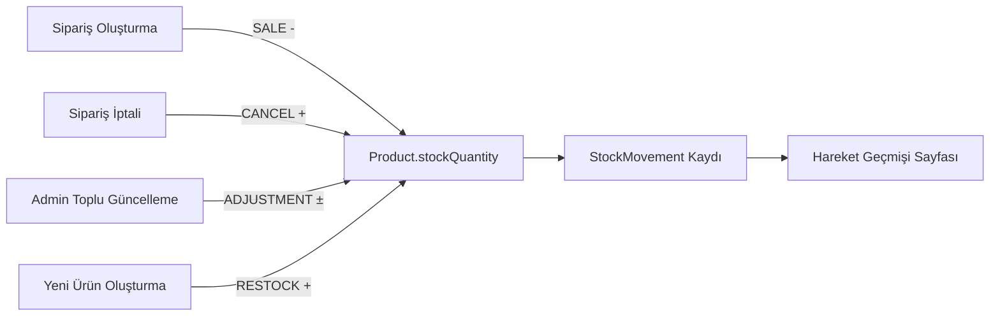

# Stok Yönetimi

Toplu stok güncelleme ve stok hareket geçmişi (audit trail) sunan, sipariş akışıyla bütünleşik stok yönetim sistemi.

## Tasarım Felsefesi

> [!IMPORTANT]
> **Temel kural: Stok hareketleri immutable (değiştirilemez) kayıtlardır.** Stok hareketleri silinmez ve güncellenmez. Tüm stok değişimleri — ister siparişten, ister iptalden, ister admin düzeltmesinden gelsin — bir `StockMovement` kaydı oluşturur. Böylece stok geçmişi her zaman denetlenebilir (audit trail) olur.

### Stok Hareket Türleri

| Tür | Yön | Kaynak | Açıklama |
|-----|-----|--------|----------|
| `SALE` | `-` | Sipariş oluşturma | Müşteri siparişi verdiğinde stoktan düşülür |
| `CANCEL` | `+` | Sipariş iptali | İptal edilen siparişin stoğu iade edilir |
| `RESTOCK` | `+` | Admin / Yeni ürün | Ürüne stok girişi (yeni ürün oluşturma veya yeniden stoklama) |
| `ADJUSTMENT` | `±` | Admin | Sayım farkı, fire, manuel düzeltme (pozitif veya negatif olabilir) |

### Stok Yönetimi Akışı



> [!NOTE]
> **Stok değişiminin tek noktası:** Mevcut `OrderServiceImpl` içinde doğrudan `productRepository.save(product)` ile yapılan stok değişimleri, yeni `StockService` üzerinden geçecek şekilde refactor edilir. Stok artırma/azaltma işlemleri hem stoğu hem hareket kaydını tek işlemde (transaction) günceller.

---

## Proposed Changes

### Backend — Stok Hareket Altyapısı

#### [NEW] [StockMovementType.java](file:///c:/e-commerce/src/main/java/com/ecommerce/api/model/StockMovementType.java)
Stok hareket türü enum'u:
```java
public enum StockMovementType {
    SALE,        // Sipariş nedeniyle stok düşüşü
    CANCEL,      // Sipariş iptali nedeniyle stok iadesi
    RESTOCK,     // Yeni ürün veya yeniden stoklama
    ADJUSTMENT   // Sayım/fire/manuel düzeltme
}
```

#### [NEW] [StockMovement.java](file:///c:/e-commerce/src/main/java/com/ecommerce/api/model/StockMovement.java)
MongoDB `stock_movements` koleksiyonu — immutable stok hareket kaydı:
```java
@Data
@NoArgsConstructor
@AllArgsConstructor
@Builder
@Document(collection = "stock_movements")
public class StockMovement {

    @Id
    private String id;

    private String productId;

    private String productName;   // Ürün adı silinse/silinirse geçmişte kalır (denormalize)

    private Integer quantityChange; // Negatif = düşüş, pozitif = artış

    private StockMovementType type;

    private String reason;        // Opsiyonel açıklama (örn. "Sayım farkı: 5 fire")

    private String performedBy;   // Opsiyonel — admin email (JWT'den)

    @CreatedDate
    private LocalDateTime createdAt;
}
```

> [!NOTE]
> `productName` alanı denormalize edilmiştir — ürün daha sonra silinse/pasife alınsa bile hareket geçmişinde ürün adı korunur.

#### [NEW] [StockMovementRepository.java](file:///c:/e-commerce/src/main/java/com/ecommerce/api/repository/StockMovementRepository.java)
Spring Data MongoDB repository:
```java
public interface StockMovementRepository extends MongoRepository<StockMovement, String> {

    Page<StockMovement> findByProductId(String productId, Pageable pageable);

    Page<StockMovement> findByProductIdIn(List<String> productIds, Pageable pageable);

    Page<StockMovement> findByType(StockMovementType type, Pageable pageable);

    Page<StockMovement> findByTypeAndCreatedAtBetween(
            StockMovementType type, LocalDateTime from, LocalDateTime to, Pageable pageable);

    Page<StockMovement> findByCreatedAtBetween(
            LocalDateTime from, LocalDateTime to, Pageable pageable);

    List<StockMovement> findByProductIdOrderByCreatedAtDesc(String productId);
}
```

#### [NEW] [StockService.java](file:///c:/e-commerce/src/main/java/com/ecommerce/api/service/StockService.java)
Stok işlemlerinin tek merkezi — servis arayüzü:
```java
public interface StockService {

    StockMovementResponse addStock(String productId, int quantity, StockMovementType type, String reason);

    StockMovementResponse deductStock(String productId, int quantity, StockMovementType type, String reason);

    StockMovementResponse adjustStock(String productId, int newStockQuantity, String reason, String performedBy);

    List<BulkStockUpdateResult> bulkUpdate(BulkStockUpdateRequest request, String performedBy);

    Page<StockMovementResponse> getMovements(StockMovementFilterParams filter);

    Page<StockMovementResponse> getMovementsByProduct(String productId, Pageable pageable);

    int getStock(String productId);
}
```

**Davranış kuralları:**
- `deductStock`: Mevcut stoktan büyük düşüş → `BadRequestException("Yetersiz stok: {ürün adı} (mevcut: X, talep: Y)")` — mevcut sipariş hatası formatı korunur
- `addStock`: Her zaman pozitif tutar, hareket `quantityChange = +quantity` olur
- `adjustStock`: Mutlak hedef değer alır — `newQuantity - currentQuantity` farkı `ADJUSTMENT` hareketi olarak kaydedilir (0 dahi olsa kaydı tutulur)
- `bulkUpdate`: Her ürün bağımsız işlenir — bir ürün hatalıysa diğerleri etkilenmez; sonuçlar `BulkStockUpdateResult[]` ile raporlanır

#### [NEW] [StockServiceImpl.java](file:///c:/e-commerce/src/main/java/com/ecommerce/api/service/StockServiceImpl.java)
```java
@Service
@RequiredArgsConstructor
public class StockServiceImpl implements StockService {

    private final ProductRepository productRepository;
    private final StockMovementRepository stockMovementRepository;

    @Override
    @Transactional
    public StockMovementResponse adjustStock(String productId, int newStockQuantity,
                                             String reason, String performedBy) {
        Product product = productRepository.findById(productId)
                .orElseThrow(() -> new ResourceNotFoundException("Product", "id", productId));

        int current = product.getStockQuantity();
        int change = newStockQuantity - current;

        product.setStockQuantity(newStockQuantity);
        productRepository.save(product);

        StockMovement movement = buildMovement(product, change, ADJUSTMENT, reason, performedBy);
        StockMovement saved = stockMovementRepository.save(movement);
        return toResponse(saved);
    }

    @Override
    @Transactional
    public List<BulkStockUpdateResult> bulkUpdate(BulkStockUpdateRequest request, String performedBy) {
        List<BulkStockUpdateResult> results = new ArrayList<>();

        for (BulkStockUpdateItem item : request.getItems()) {
            try {
                StockMovementResponse movement = adjustStock(
                        item.getProductId(), item.getNewStockQuantity(), item.getReason(), performedBy);
                results.add(BulkStockUpdateResult.success(item.getProductId(), movement));
            } catch (Exception e) {
                results.add(BulkStockUpdateResult.failure(item.getProductId(), e.getMessage()));
            }
        }
        return results;
    }

    // ... getMovements, getMovementsByProduct, getStock, buildMovement, toResponse
}
```

> [!NOTE]
> **Redis cache:** `ProductServiceImpl` içindeki `@CacheEvict` deseni korunur. Stok güncelleme sonrası `ProductServiceImpl` içinde call-through yapılır veya `adjustStock` metodu `@CacheEvict(value = "products", key = "#productId")` annotation'ı alır.

#### [NEW] DTO'lar

**[BulkStockUpdateRequest.java](file:///c:/e-commerce/src/main/java/com/ecommerce/api/dto/request/BulkStockUpdateRequest.java)**
```java
@Data
@Builder
public class BulkStockUpdateRequest {
    @NotEmpty(message = "En az bir ürün gönderilmelidir")
    private List<BulkStockUpdateItem> items;

    @Data
    @Builder
    public static class BulkStockUpdateItem {
        @NotBlank(message = "Ürün ID boş olamaz")
        private String productId;

        @NotNull(message = "Yeni stok miktarı zorunludur")
        @Min(value = 0, message = "Stok miktarı negatif olamaz")
        private Integer newStockQuantity;

        private String reason;  // opsiyonel
    }
}
```

**[BulkStockUpdateResult.java](file:///c:/e-commerce/src/main/java/com/ecommerce/api/dto/response/BulkStockUpdateResult.java)** — Her ürün için bağımsız sonuç:
```java
@Data
@Builder
public class BulkStockUpdateResult {
    private String productId;
    private String productName;
    private boolean success;
    private Integer oldStockQuantity;   // success=true ise
    private Integer newStockQuantity;   // success=true ise
    private String message;             // hata mesajı (success=false ise)
}
```

**[StockMovementResponse.java](file:///c:/e-commerce/src/main/java/com/ecommerce/api/dto/response/StockMovementResponse.java)**
```java
@Data
@Builder
public class StockMovementResponse {
    private String id;
    private String productId;
    private String productName;
    private Integer quantityChange;  // negatif = düşüş, pozitif = artış
    private StockMovementType type;
    private String reason;
    private String performedBy;
    private LocalDateTime createdAt;
}
```

**[StockMovementFilterParams.java](file:///c:/e-commerce/src/main/java/com/ecommerce/api/dto/request/StockMovementFilterParams.java)**
```java
@Data
@Builder
public class StockMovementFilterParams {
    private String productSearch;           // ürün adı arama (case-insensitive)
    private String productId;               // tek ürün filtresi
    private StockMovementType type;         // hareket türü
    private LocalDateTime startDate;        // başlangıç tarihi
    private LocalDateTime endDate;          // bitiş tarihi
    private int page = 0;
    private int size = 20;
}
```

#### [NEW] [AdminStockController.java](file:///c:/e-commerce/src/main/java/com/ecommerce/api/controller/AdminStockController.java)
```java
@RestController
@RequestMapping("/api/v1/admin/stock")
@PreAuthorize("hasRole('ADMIN')")
public class AdminStockController {

    private final StockService stockService;

    @PostMapping("/bulk")
    public ResponseEntity<ApiResponse<List<BulkStockUpdateResult>>> bulkUpdate(
            @Valid @RequestBody BulkStockUpdateRequest request,
            @AuthenticationPrincipal UserPrincipal principal) {
        List<BulkStockUpdateResult> results =
                stockService.bulkUpdate(request, principal.getEmail());
        return ResponseEntity.ok(ApiResponse.success(results, "Toplu stok güncelleme tamamlandı"));
    }

    @GetMapping("/movements")
    public ResponseEntity<ApiResponse<Page<StockMovementResponse>>> getMovements(
            StockMovementFilterParams filter) {
        return ResponseEntity.ok(ApiResponse.success(
                stockService.getMovements(filter), "Stok hareketleri listelendi"));
    }

    @GetMapping("/movements/product/{productId}")
    public ResponseEntity<ApiResponse<Page<StockMovementResponse>>> getMovementsByProduct(
            @PathVariable String productId,
            @RequestParam(defaultValue = "0") int page,
            @RequestParam(defaultValue = "20") int size) {
        return ResponseEntity.ok(ApiResponse.success(
                stockService.getMovementsByProduct(productId, PageRequest.of(page, size)),
                "Ürün stok hareketleri listelendi"));
    }
}
```

> [!NOTE]
> `productSearch` (ürün adı araması) filtreli geçmiş sorgusu, önce `ProductRepository`'de ürün adıyla eşleşen ID'leri bulur, ardından `productIdIn` ile hareketleri çeker — MongoDB join gerektirmez.

---

### Backend — Mevcut Dosya Entegrasyonları

#### [MODIFY] [OrderServiceImpl.java](file:///c:/e-commerce/src/main/java/com/ecommerce/api/service/OrderServiceImpl.java)

Sipariş oluşturma — stok düşüşü artık hareket kaydı oluşturur:
```diff
             // Stok düş
             product.setStockQuantity(product.getStockQuantity() - cartItem.getQuantity());
             productRepository.save(product);
+            stockService.deductStock(product.getId(), cartItem.getQuantity(),
+                    StockMovementType.SALE, "Sipariş oluşturuldu");
```

Sipariş iptali — stok iadesi artık hareket kaydı oluşturur:
```diff
             product.setStockQuantity(product.getStockQuantity() + orderItem.getQuantity());
             productRepository.save(product);
+            stockService.addStock(product.getId(), orderItem.getQuantity(),
+                    StockMovementType.CANCEL, "Sipariş iptal edildi");
```

> [!WARNING]
> `stockService.deductStock` içinde `productRepository.findById` yeniden yapıldığı için, mevcut döngü içindeki `product` nesnesi `stale` kalabilir. Bu nedenle `deductStock`/`addStock` çağrıları **öncesindeki** `product.setStockQuantity(...)` ve `productRepository.save(product)` satırları kaldırılır — iş tamamen `StockService`'e devredilir. Aksi takdirde çift stok değişimi olur.

```diff
-            // Stok düş
-            product.setStockQuantity(product.getStockQuantity() - cartItem.getQuantity());
-            productRepository.save(product);
-            stockService.deductStock(product.getId(), cartItem.getQuantity(),
+            // Stok düş + hareket kaydı (StockService tek noktadan yönetir)
+            stockService.deductStock(product.getId(), cartItem.getQuantity(),
                     StockMovementType.SALE, "Sipariş oluşturuldu");
```

**Sipariş ID sorunu:** Sipariş henüz kaydedilmediği için (`orderRepository.save` döngüden sonra) reason mesajında sipariş ID'si kullanılamaz. Çözüm: önce `order.getId()` yerine geçici olarak "Sipariş oluşturma" yazılır VE/VEYA sipariş kaydı döngüden önce `id`'si doldurulmuş olarak oluşturulup sonra kaydedilir. **Önerilen:** Sipariş geçici ID'siz kaydedilirken reason olarak `"Sipariş oluşturma (sepetteki ürünler)"` yazılır — yeterli bilgi sağlar.

#### [MODIFY] [ProductServiceImpl.java](file:///c:/e-commerce/src/main/java/com/ecommerce/api/service/ProductServiceImpl.java)

Yeni ürün oluşturulurken başlangıç stoğu `RESTOCK` hareketi olarak kaydedilir:
```diff
         Product product = productMapper.toEntity(request);
         product.setActive(true);
         Product savedProduct = productRepository.save(product);
+        stockService.addStock(savedProduct.getId(), product.getStockQuantity(),
+                StockMovementType.RESTOCK, "Yeni ürün oluşturuldu");
         return productMapper.toResponse(savedProduct);
```

#### [MODIFY] [UpdateProductRequest.java](file:///c:/e-commerce/src/main/java/com/ecommerce/api/dto/request/UpdateProductRequest.java)

> [!NOTE]
> `stockQuantity` alanı `UpdateProductRequest`'te kalır — mevcut tek ürün düzenleme formu (AdminProducts) stok alanını değiştirmeye devam edebilir. Ancak bu yol `ADJUSTMENT` hareketi oluşturmaz. **Öneri:** `ProductServiceImpl.updateProduct` içinde `stockQuantity` değişmişse fark kadar `ADJUSTMENT` kaydı eklenir.

```diff
     @Override
+    @CacheEvict(value = "products", key = "#id")
     public ProductResponse updateProduct(String id, UpdateProductRequest request) {
         Product product = productRepository.findById(id)
                 .orElseThrow(() -> new ResourceNotFoundException("Product", "id", id));

+        int oldStock = product.getStockQuantity();
         productMapper.updateEntity(request, product);
         Product updatedProduct = productRepository.save(product);
+
+        // Stok değişmişse ADJUSTMENT hareketi kaydet
+        if (!Objects.equals(oldStock, updatedProduct.getStockQuantity())) {
+            stockService.addStock(updatedProduct.getId(),
+                    updatedProduct.getStockQuantity() - oldStock,
+                    StockMovementType.ADJUSTMENT, "Ürün düzenlendi");
+        }
         return productMapper.toResponse(updatedProduct);
     }
```

---

### Frontend — Toplu Stok ve Hareket Geçmişi

#### [NEW] [adminStockService.ts](file:///c:/e-commerce/frontend/src/api/adminStockService.ts)
```typescript
import axiosClient from './axiosClient';
import type {
  ApiResponse,
  BulkStockUpdateItem,
  BulkStockUpdateResult,
  PageResponse,
  StockMovement,
  StockMovementFilterParams,
  StockMovementType,
} from '../types';

export const adminStockService = {
  async bulkUpdateStock(
    items: BulkStockUpdateItem[]
  ): Promise<ApiResponse<BulkStockUpdateResult[]>> {
    const response = await axiosClient.post<ApiResponse<BulkStockUpdateResult[]>>(
      '/api/v1/admin/stock/bulk',
      { items }
    );
    return response.data;
  },

  async getMovements(
    params: StockMovementFilterParams
  ): Promise<ApiResponse<PageResponse<StockMovement>>> {
    const response = await axiosClient.get<ApiResponse<PageResponse<StockMovement>>>(
      '/api/v1/admin/stock/movements',
      { params }
    );
    return response.data;
  },

  async getProductMovements(
    productId: string,
    page = 0,
    size = 20
  ): Promise<ApiResponse<PageResponse<StockMovement>>> {
    const response = await axiosClient.get<ApiResponse<PageResponse<StockMovement>>>(
      `/api/v1/admin/stock/movements/product/${productId}`,
      { params: { page, size } }
    );
    return response.data;
  },
};
```

#### [MODIFY] [types/index.ts](file:///c:/e-commerce/frontend/src/types/index.ts)
```typescript
// Stock Movement Types
export type StockMovementType = 'SALE' | 'CANCEL' | 'RESTOCK' | 'ADJUSTMENT';

export interface StockMovement {
  id: string;
  productId: string;
  productName: string;
  quantityChange: number; // negatif = düşüş, pozitif = artış
  type: StockMovementType;
  reason?: string;
  performedBy?: string;
  createdAt: string;
}

export interface BulkStockUpdateItem {
  productId: string;
  newStockQuantity: number;
  reason?: string;
}

export interface BulkStockUpdateResult {
  productId: string;
  productName: string;
  success: boolean;
  oldStockQuantity?: number;
  newStockQuantity?: number;
  message?: string;
}

export interface StockMovementFilterParams {
  productSearch?: string;
  productId?: string;
  type?: StockMovementType;
  startDate?: string;
  endDate?: string;
  page?: number;
  size?: number;
}
```

#### [NEW] [AdminStock.tsx](file:///c:/e-commerce/frontend/src/pages/admin/AdminStock.tsx)
Toplu stok güncelleme sayfası:

**Özellikler:**
- Ürün tablosu: Ürün adı, kategori, mevcut stok, **yeni stok input'u**, opsiyonel **gerekçe input'u**
- **"Stok Sıfır Ürünler"** hızlı filtre butonu — yalnızca `stockQuantity === 0` olan ürünleri listeler
- **"Stok Girdisi Olanlar"** hızlı filtre — yalnızca `stockQuantity > 0` olan ürünler
- Arama + kategori filtresi (mevcut `AdminProducts` deseninde)
- **"Toplu Güncelle"** butonu → yalnızca değiştirilmiş satırları gönderir (`newStockQuantity !== oldStockQuantity`)
- Gönderim öncesi doğrulama modal'ı: "3 ürün güncellenecek" özeti
- Sonuç özeti: Başarılı `showToast('success', 'X ürünün stoğu güncellendi')`, kısmi hata `showToast('warning', 'Y ürün güncellenemedi')`
- Tam hata: `showToast('error', ...)`
- Her satırda mevcut stok durum rozeti (Tükendi → kırmızı, Düşük (< 5) → amber, Normal → yeşil)
- Sayfalama (mevcut `Pagination` bileşeni)
- `useToast` ile mevcut toast altyapısı kullanılır

**Ana state yapısı:**
```typescript
interface StockEditRow {
  productId: string;
  newStockQuantity: number;
  reason?: string;
  isDirty: boolean; // değiştirilmiş satır işareti
}
```

#### [NEW] [AdminStockMovements.tsx](file:///c:/e-commerce/frontend/src/pages/admin/AdminStockMovements.tsx)
Stok hareket geçmişi sayfası:

**Özellikler:**
- Tablo: Tarih, Ürün, Hareket Türü (renkli rozet), Miktar Değişimi (+/- renkli), Neden, İşlemi Yapan
- **Hareket türü rozetleri:**
  - `SALE` → kırmızı (`bg-red-500/10 border-red-500/30 text-red-400`)
  - `CANCEL` → yeşil (`bg-emerald-500/10 border-emerald-500/30 text-emerald-400`)
  - `RESTOCK` → mavi (`bg-blue-500/10 border-blue-500/30 text-blue-400`)
  - `ADJUSTMENT` → amber (`bg-amber-500/10 border-amber-500/30 text-amber-400`)
- **Miktar gösterimi:** `SALE` için `-5` (kırmızı), `CANCEL`/`RESTOCK` için `+10` (yeşil), `ADJUSTMENT` işarete göre
- **Filtreler:** Ürün adı arama, hareket türü dropdown'ı, tarih aralığı (başlangıç/bitiş date input'ları), temizle butonu
- Sayfalama (`Pagination` bileşeni), boş durum ve yükleniyor spinner'ı (mevcut admin sayfa desenlerinde)
- Ürüne tıklanınca `/admin/stock/movements?productId=X` filtresi (opsiyonel detay)

---

### Frontend — Router ve Menü

#### [MODIFY] [App.tsx](file:///c:/e-commerce/frontend/src/App.tsx)
```diff
 import { AdminProducts } from './pages/admin/AdminProducts';
+import { AdminStock } from './pages/admin/AdminStock';
+import { AdminStockMovements } from './pages/admin/AdminStockMovements';
 ...
                     <Route path="/admin/products" element={<AdminProducts />} />
+                    <Route path="/admin/stock" element={<AdminStock />} />
+                    <Route path="/admin/stock/movements" element={<AdminStockMovements />} />
                     <Route path="/admin/categories" element={<AdminCategories />} />
```

#### [MODIFY] [AdminLayout.tsx](file:///c:/e-commerce/frontend/src/components/admin/AdminLayout.tsx)
```diff
 import { LayoutDashboard, ShoppingBag, FolderOpen, ClipboardList, Store, LogOut, Shield, Tag, Users } from 'lucide-react';
+import { PackageSearch, History } from 'lucide-react';
 ...
             <NavLink
               to="/admin/products"
               ...
             >
               <ShoppingBag className="w-5 h-5" />
               <span>Ürün Yönetimi</span>
             </NavLink>
+            <NavLink
+              to="/admin/stock"
+              className={({ isActive }) =>
+                `flex items-center space-x-3 px-4 py-2.5 rounded-lg text-sm font-semibold transition-all ${isActive
+                  ? 'bg-indigo-500/10 border border-indigo-500/20 text-indigo-600'
+                  : 'text-slate-500 hover:text-slate-900 hover:bg-slate-855 border border-transparent'
+                }`
+              }
+            >
+              <PackageSearch className="w-5 h-5" />
+              <span>Toplu Stok Yönetimi</span>
+            </NavLink>
+            <NavLink
+              to="/admin/stock/movements"
+              className={({ isActive }) =>
+                `flex items-center space-x-3 px-4 py-2.5 rounded-lg text-sm font-semibold transition-all ${isActive
+                  ? 'bg-indigo-500/10 border border-indigo-500/20 text-indigo-600'
+                  : 'text-slate-500 hover:text-slate-900 hover:bg-slate-855 border border-transparent'
+                }`
+              }
+            >
+              <History className="w-5 h-5" />
+              <span>Stok Hareketleri</span>
+            </NavLink>
```

---

## Dosya Özeti

| Dosya | İşlem | Katman | Açıklama |
|-------|-------|--------|----------|
| `StockMovementType.java` | YENİ | Backend — model | Stok hareket türü enum'u |
| `StockMovement.java` | YENİ | Backend — model | Immutable hareket kaydı (MongoDB) |
| `StockMovementRepository.java` | YENİ | Backend — repository | Hareket sorguları |
| `StockService.java` | YENİ | Backend — servis | Stok işlem arayüzü |
| `StockServiceImpl.java` | YENİ | Backend — servis | Tek noktadan stok + hareket yönetimi |
| `BulkStockUpdateRequest.java` | YENİ | Backend — DTO | Toplu güncelleme isteği |
| `BulkStockUpdateResult.java` | YENİ | Backend — DTO | Ürün bazlı sonuç |
| `StockMovementResponse.java` | YENİ | Backend — DTO | Hareket yanıtı |
| `StockMovementFilterParams.java` | YENİ | Backend — DTO | Geçmiş filtre parametreleri |
| `AdminStockController.java` | YENİ | Backend — controller | `/api/v1/admin/stock/*` endpoint'leri |
| `OrderServiceImpl.java` | GÜNCELLEME | Backend — servis | SALE/CANCEL hareket kayıtları |
| `ProductServiceImpl.java` | GÜNCELLEME | Backend — servis | RESTOCK + ADJUSTMENT kayıtları |
| `adminStockService.ts` | YENİ | Frontend — API | Stok API servisi |
| `types/index.ts` | GÜNCELLEME | Frontend — types | Stok tipleri |
| `AdminStock.tsx` | YENİ | Frontend — admin | Toplu stok güncelleme sayfası |
| `AdminStockMovements.tsx` | YENİ | Frontend — admin | Hareket geçmişi sayfası |
| `App.tsx` | GÜNCELLEME | Frontend — router | Admin rotaları |
| `AdminLayout.tsx` | GÜNCELLEME | Frontend — layout | Menü bağlantıları |

## Open Questions

> [!NOTE]
> **Toplu güncelleme semantiği:** Toplu güncellemede her ürün için **mutlak hedef stok** (`newStockQuantity`) girilir. Bu, "şu anki değeri ne olursa olsun şu değere ayarla" anlamına gelir. Alternatif olarak delta modu (örn. `+10`, `-5`) eklenebilir. Plan mutlak hedef üzerine kuruludur; delta modu istenirse `BulkStockUpdateItem`'a `mode: 'SET' | 'DELTA'` alanı eklenerek her ikisi desteklenebilir.

> [!NOTE]
> **Düşük stok uyarısı:** Şu an için düşük stok eşiği (örn. `< 5`) yalnızca görsel rozet olarak frontend'de gösteriliyor. Backend'de otomatik e-posta/bildirim tetiklenmesi isteniyorsa ayrı bir `lowStockThreshold` alanı ve schedule job'ı eklenebilir — bu kapsam dışı tutulmuştur.

> [!NOTE]
> **Ürün silme davranışı:** Stok hareketleri immutable olduğundan, ürün `active=false` yapılsa da hareket geçmişi korunur (denormalize `productName` sayesinde). Tam silme (`delete`) işlemi önerilmez — mevcut sistemde zaten ürünler soft-delete (`active=false`) ediliyor.

## Verification Plan

### Backend Testleri
1. **Sipariş oluşturma:** Sipariş verildiğinde `Product.stockQuantity` düşer ve `SALE` tipinde `StockMovement` kaydı oluşur
2. **Sipariş iptali:** Sipariş iptalinde stok iade edilir ve `CANCEL` kaydı oluşur
3. **Toplu güncelleme:** `POST /api/v1/admin/stock/bulk` — 10 ürün gönderildiğinde tümü güncellenir; hatalı ürün ID'si ile kısmi başarı raporlanır
4. **Yetersiz stok:** `deductStock` mevcut stoktan büyükse `BadRequestException` fırlatır, mevcut format korunur
5. **ADJUSTMENT:** `adjustStock` mutlak değerle çağrıldığında fark kadar hareket kaydı oluşur
6. **Filtreleme:** Tür, tarih aralığı, ürün adı filtreleri doğru çalışır; sayfalama tutarlıdır

### Frontend Testleri
1. **AdminStock:** Ürün listesi yüklenir, yeni stok girilir, filtreler çalışır, toplu güncelleme sonucu özetlenir
2. **AdminStockMovements:** Hareket geçmişi yüklenir, tür rozetleri doğru renklerde, +/- işaretleri doğru gösterilir
3. **Toast entegrasyonu:** Başarılı/kısmi başarılı/hatalı güncelleme senaryoları toast ile doğrulanır
4. **Filtreler:** Ürün adı arama, tür dropdown'ı, tarih aralığı temizleme/doldurma davranışı
5. **Router:** `/admin/stock` ve `/admin/stock/movements` rotaları admin dışı kullanıcıda korunur
6. **Mobil:** Tablolar yatay kaydırmalı (overflow-x-auto) çalışır